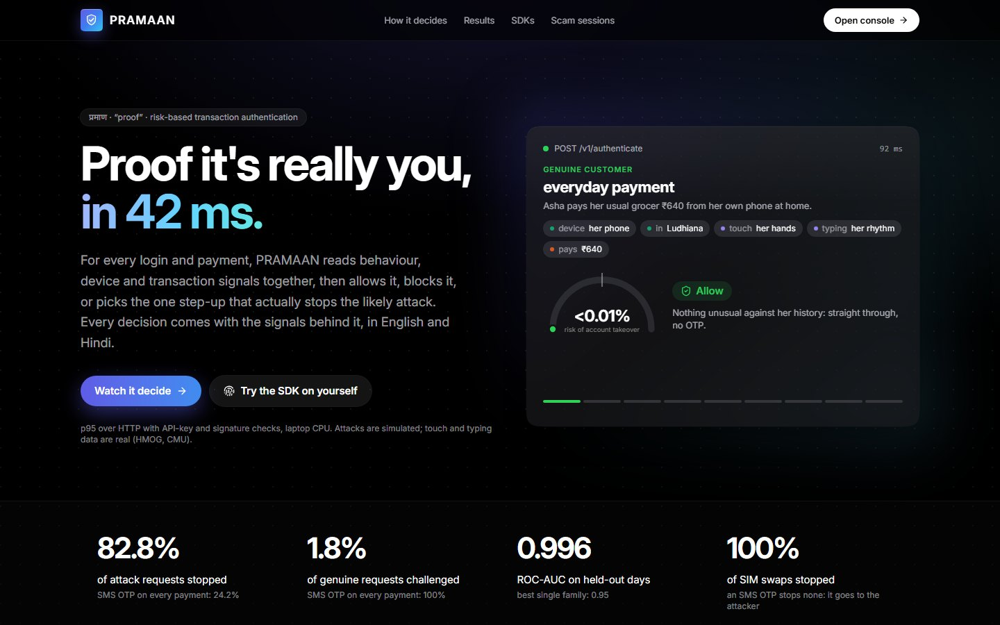
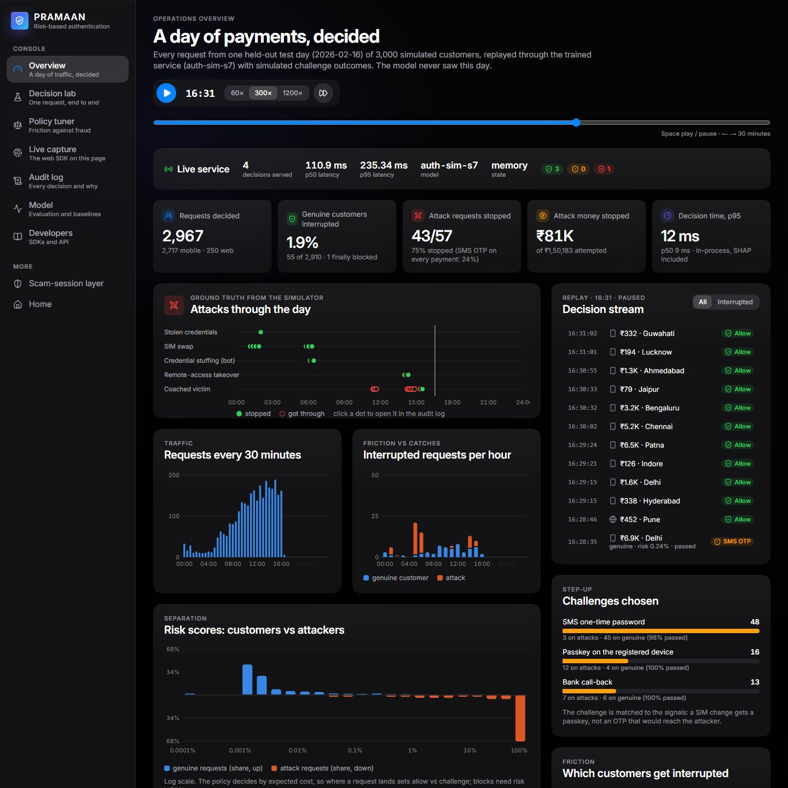
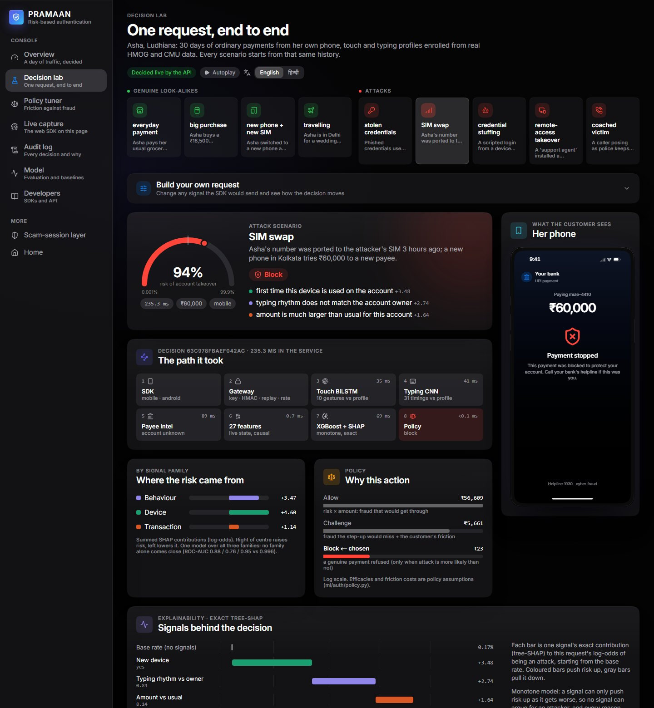
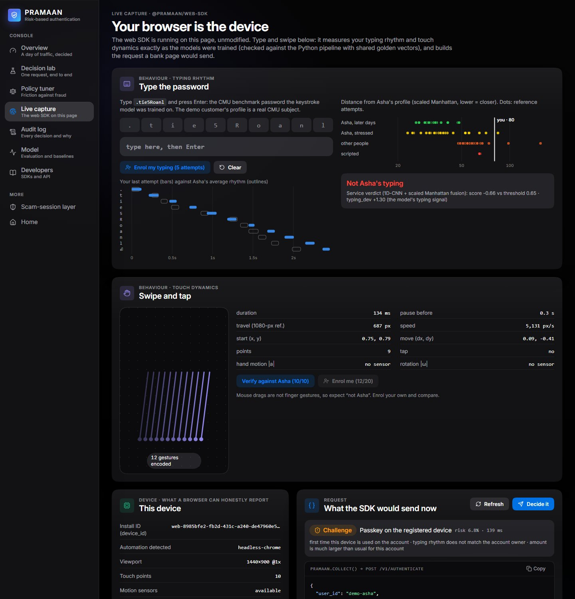
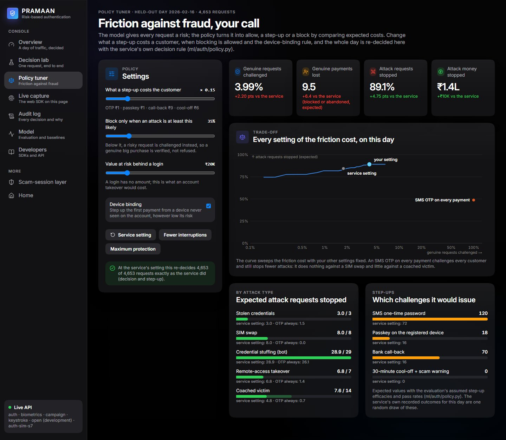
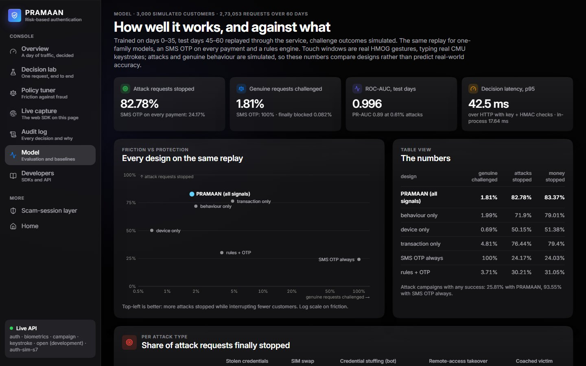

# PRAMAAN — fast and secure online transaction authentication

**PRAMAAN** — **P**arallel **R**isk-**A**daptive **M**ulti-modal **A**uthentication & **A**nomaly **N**etwork
(प्रमाण, "proof"). Team **CaffeineEaters**: Abhinav Saini, Aditi Pundir, Mannat Kaur, Aryamann Sharma.

A cloud risk-authentication service: for every login or payment it combines **behaviour**, **device information**
and **transaction patterns**, decides **allow / challenge / block** in real time, picks the challenge that actually
stops the likely attack, and returns **the signals behind the decision**.

```
POST /v1/authenticate  →  { decision, risk_score, challenge_type, reasons (EN/HI), signals (tree-SHAP), latency_ms }
POST /v1/challenge/verify  →  passed: allow (+ trust the device) · failed: block, lock 30 min
```

Built on the RAKSHAM scam-detection work (IIT Delhi): its touch-biometrics model, payee-risk model and API skeleton
are reused; the scam-session demo is kept at `/scam` in the console and documented in `docs/README_RAKSHAM.md`.

> Attack and genuine behaviours are **simulated**; touch windows are **real** HMOG gestures scored by the real model;
> challenge efficacies are **assumptions**. The numbers validate the service and compare designs, not real-world accuracy.

## Results (`ml/reports/auth.md`, `backend/reports/auth_latency.md`)

3,000 simulated customers, 273k requests over 60 days; trained on days 0–35, test days 45–60 replayed through the
service, including simulated challenge outcomes.

| design | genuine requests challenged | genuine finally blocked | attack requests stopped | attack money stopped |
|---|---|---|---|---|
| **risk engine (all signals)** | **1.8%** | **0.08%** | **82.8%** | **83.4%** |
| behaviour signals only (touch + typing + session) | 2.0% | 0.10% | 71.9% | 79.0% |
| device signals only | 0.7% | 0.04% | 50.2% | 51.4% |
| transaction signals only | 4.8% | 0.23% | 76.4% | 79.4% |
| SMS OTP on every payment | 100% | 3.0% | 24.2% | 24.0% |
| rules engine + SMS OTP | 3.7% | 0.12% | 30.2% | 31.1% |

* Test ROC-AUC 0.996 (all signals) vs 0.88 / 0.76 / 0.95 for one family alone. Adding typing rhythm lifted the
  behaviour family from ROC-AUC 0.80 to 0.88 and from 62.8% to 71.9% of attacks stopped with half the challenges; on
  the full engine it is neutral in ranking (0.996 vs 0.997) and moves the operating point to fewer genuine challenges
  (1.8% vs 2.0%) and slightly fewer attack requests stopped (82.8% vs 85.8%), mostly coached victims, whose own typing
  looks normal.
* Per attack (finally stopped): stolen credentials 100%, SIM swap 100%, bots 100%, remote-access takeover 90%,
  **coached victim 46%** (the real owner on their own phone is the hardest case). Hard-difficulty attacks: 68%.
* Typing rhythm (`ml/reports/keystroke_cmu.md`): a 1D-CNN keystroke encoder trained on the CMU DSL-StrongPassword
  data (51 people typing `.tie5Roanl`). On people it never saw, enrolled on 4 earlier sessions and tested on 4 later
  ones: per-user EER 13.0% (scaled Manhattan 19.9%; fused 12.2%, 8.5% over 3 tries). Our scaled Manhattan reproduces
  the published 9.6% on the paper's own protocol. In the service it is the `typing_dev` behaviour signal for password /
  PIN entry, on web as well as mobile.
* Device binding: the first payment from a device never seen on the account is always stepped up (passkey on the
  registered phone when one exists or the SIM just changed), however low the model's risk.
* Latency over HTTP on a laptop **CPU** with API-key + HMAC checks: **p95 42 ms** (no touch data),
  **p95 69 ms** with 10 touch gestures verified by the BiLSTM. In-process decision (features + model + SHAP + policy): p95 18 ms. (HTTP figures measured before the typing
  signal; the 84k-parameter typing CNN adds a CPU forward pass per attempt.)

## Console

`frontend/` (Next.js 16, React 19, Tailwind 4). It plays recordings of the API's own output by default and
decides live when `NEXT_PUBLIC_PRAMAAN_API` points at a running service.

| | |
|---|---|
|  |  |
|  |  |
|  |  |

| page | what it shows |
|---|---|
| `/` | the product: an animated decision card cycling through the recorded scenarios, results vs SMS OTP, the three signal families, matched step-ups, the request path, the SDKs |
| `/console` | **Operations overview**: one held-out test day (4,653 requests, 61 attacks) replayed through the trained service on a compressed clock: KPIs, attacks by type and outcome on a 24-hour lane, traffic and interruptions per hour, risk distribution of customers vs attackers, challenge mix, signals behind interruptions, a live decision stream; plus the running service's own counters when connected |
| `/console/lab` | **Decision lab**: nine scenarios (genuine look-alikes next to attacks) or a request built by hand; risk gauge, per-stage pipeline trace (`timings_ms`), exact SHAP waterfall, family split, the policy's expected cost of each action, the customer's phone (OTP / passkey / call-back / cool-off / blocked, EN/HI), the challenge loop, request / response JSON and generated integration code |
| `/console/policy` | **Policy tuner**: change what a step-up costs a customer, when blocking is allowed, the value behind a login and the device-binding rule; the held-out day is re-decided in the browser with the service's own decision rule (it reproduces all 4,653 recorded decisions at the service's setting) and shows the friction / protection trade-off curve, expected attacks and money stopped, and the step-up mix |
| `/console/capture` | **Live capture**: the web SDK running on the page. Type `.tie5Roanl` and see your rhythm against the demo customer's real CMU profile (or enrol your own in 5 attempts), with the service's verdict when live; swipe on a pad and see the 21 features per gesture; the device signals and the exact request the SDK would send |
| `/console/audit` | **Audit log**: every decision of the recorded day, this session, or the live service, with filters, search, a detail drawer and CSV export |
| `/console/model` | **Model**: every design on the same replay (friction vs protection), per-attack heatmap, difficulty, ranking, feature importance, typing and touch EER, latency, caveats |
| `/console/developers` | **Developers**: integration flow, quickstarts (web, Node, Android, Python, cURL), what each SDK can see, endpoints, security, privacy, how the SDKs are verified |
| `/scam` | the RAKSHAM scam-session layer (unchanged) |

## Client SDKs

`sdk/` (see `sdk/README.md`): a **web SDK** (`@pramaan/web-sdk`, TypeScript) and an **Android SDK**
(`com.pramaan.sdk`, Kotlin), both without dependencies. They collect touch gestures (21 features each, never
coordinates), typing rhythm (31 timings, never keys), session timing and device signals on the customer's device; the
Android SDK adds root, emulator, remote-control apps, screen recording, SIM change and an unknown caller on the line.
Their clients sign requests, retry safely and fall back to an SMS OTP when the service is down; the web SDK also has
drop-in step-up screens (OTP, passkey, call-back, cool-off with a scam warning, in English or Hindi).

Both SDKs are tested against **golden vectors from the training pipeline's own code** (`sdk/spec/make_golden.py`):
the same raw touch frames, sensor samples and key events must give the features the models were trained on, to 1e-9.
Web: 31 unit tests + 7 end-to-end tests against a running API (including signed requests through a secured gateway).
Android: 13 JVM tests (golden vectors, client, live API); library and sample compile against Android API 35.

## Layout

```
sdk/web/              browser SDK + signing client (TypeScript): collectors, gesture / keystroke math, PramaanClient
sdk/android/          Android SDK (Kotlin): Pramaan entry point, capture, device signals, PIN pad, client; sample app
sdk/spec/             golden vectors from the training pipeline (make_golden.py -> golden.json)
ml/models/keystroke/  1D-CNN typing-rhythm encoder (CMU keystroke data): data, model, train, evaluate, scorer
ml/auth/          the authentication service core (PRAMAAN)
  geo.py            IP intelligence (hosting / anonymiser ranges), distances, load-balancer geo header
  state.py          live state: users, device registry, per-device / per-IP fan-out, pending challenges (memory | Redis)
  features.py       26 causal features: behaviour 5 · device 13 · transaction 8
  sim.py            account-takeover simulator (genuine look-alikes + 5 attacks, difficulty knob, real HMOG touch)
  model.py          monotone XGBoost, prior correction, tree-SHAP
  policy.py         challenge choice (sms_otp | passkey | bank_callback | cool_off) + expected-cost decision
  engine.py         decision + challenge loop
  evaluate.py       training + replay evaluation -> ml/reports/auth.md
  demo.py           demo customer and scenarios; packed real gestures for containers
backend/          FastAPI: app.py, auth_service.py, security.py (keys, HMAC, replay, rate limit), audit.py;
                  record_auth_demo.py / record_auth_traffic.py / export_console_report.py write the console's data
frontend/         Next.js: / (product), /console/* (overview, lab, capture, audit, model, developers), /scam (RAKSHAM)
deploy/           cloudrun.sh (Cloud Run, Secret Manager, Memorystore, load balancer + Cloud Armor)
Dockerfile, docker-compose.yml, requirements-serve.txt
ml/models, ml/campaign, ml/engine, ml/sim   RAKSHAM components (touch biometrics, payee risk, scam sessions)
docs/             ARCHITECTURE.md (PRAMAAN), DEPLOY.md, ARCHITECTURE_RAKSHAM.md, README_RAKSHAM.md
tests/            pytest (100 tests; tests/test_auth.py covers the PRAMAAN service)
```

## Run it

```bash
source ~/envs/raksham/Scripts/activate
pip install -r requirements.txt          # + torch (CUDA or CPU build)

# API (touch biometrics + payee intelligence + authentication); docs at http://127.0.0.1:8000/docs
PRAMAAN_SERVICES=biometrics,keystroke,campaign,auth BIO_CALIB=ml/auth/artifacts/bio_calib.pkl \
  uvicorn backend.app:app --port 8000

# console on http://localhost:3000 (without NEXT_PUBLIC_PRAMAAN_API it plays the recordings)
cd frontend && npm ci && NEXT_PUBLIC_PRAMAAN_API=http://127.0.0.1:8000 npm run dev

# SDKs
cd sdk/web && npm ci && npm test && PRAMAAN_API=http://127.0.0.1:8000 npm run test:live
cd sdk/android && gradle :pramaan:testDebugUnitTest :sample:assembleDebug
```

On Windows Git Bash, prefix commands that set path-like env values (e.g. `PRAMAAN_OPEN_PATHS=/v1/...`) with
`MSYS_NO_PATHCONV=1`, otherwise Git Bash rewrites them into Windows paths.

Rebuild everything from data:

```bash
python -m ml.models.biometrics.data      # HMOG gesture cache from DATA/hmog_dataset.zip (once)
python -m ml.models.keystroke.train --seed 0   # 1D-CNN typing encoder (seeds 0-2, ~2 min each, CUDA optional)
python -m ml.models.keystroke.evaluate   # held-out users vs baselines -> ml/reports/keystroke_cmu.md + artefact
python -m ml.auth.evaluate               # simulate, train, evaluate (~12 min) -> ml/reports/auth.md + model
python -m ml.auth.demo                   # packed demo gestures
BIO_CALIB=ml/auth/artifacts/bio_calib.pkl python -m backend.record_auth_demo   # -> frontend/public/data/auth_demo.json
python -m backend.record_auth_traffic    # one held-out test day through the service -> frontend/public/data/auth_traffic.json
python -m backend.export_console_report  # evaluation reports for the console -> frontend/public/data/model_report.json
python sdk/spec/make_golden.py           # SDK golden vectors from the training pipeline -> sdk/spec/golden.json
python -m backend.bench_auth --url http://127.0.0.1:8000     # HTTP latency -> backend/reports/auth_latency.md
pytest tests -q
```

Cloud deployment: `docs/DEPLOY.md` (Docker / Cloud Run in Mumbai, asia-south1). The Dockerfile and deploy script
have not been run on this machine yet (no Docker or gcloud installed).

## API

| endpoint | what it does |
|---|---|
| `POST /v1/authenticate` | decide a login / payment: decision, risk, challenge type, EN/HI reasons, all signal contributions, the base log-odds they add up from, per-stage timings |
| `POST /v1/challenge/verify` | result of the step-up → final allow / block; passkey or call-back makes the device trusted |
| `POST /v1/biometrics/enroll` · `/verify` | enrol a user's touch profile (≥ 20 gestures) · score 10-20 gestures against it |
| `POST /v1/keystroke/enroll` · `/verify` | enrol a user's typing rhythm (≥ 5 password / PIN attempts, 31 key timings each) · score one attempt |
| `GET /v1/auth/decisions` · `/v1/auth/stats` | audit feed and counters (decisions, challenge mix, p50/p95 latency) |
| `GET /v1/auth/scenarios` · `POST /v1/auth/demo/{scenario}` · `POST /v1/auth/demo/verify` | demo customer (open paths for the public console) |
| `GET /health` | loaded services, security mode, model version, state / audit backends |

Security (env-configured, see `docs/DEPLOY.md`): `X-API-Key`; `X-Timestamp` + `X-Signature` = HMAC-SHA256 of
`"<timestamp>.<body>"` with 5-minute window and replay rejection; per-key token-bucket rate limit; TLS at the load balancer.
