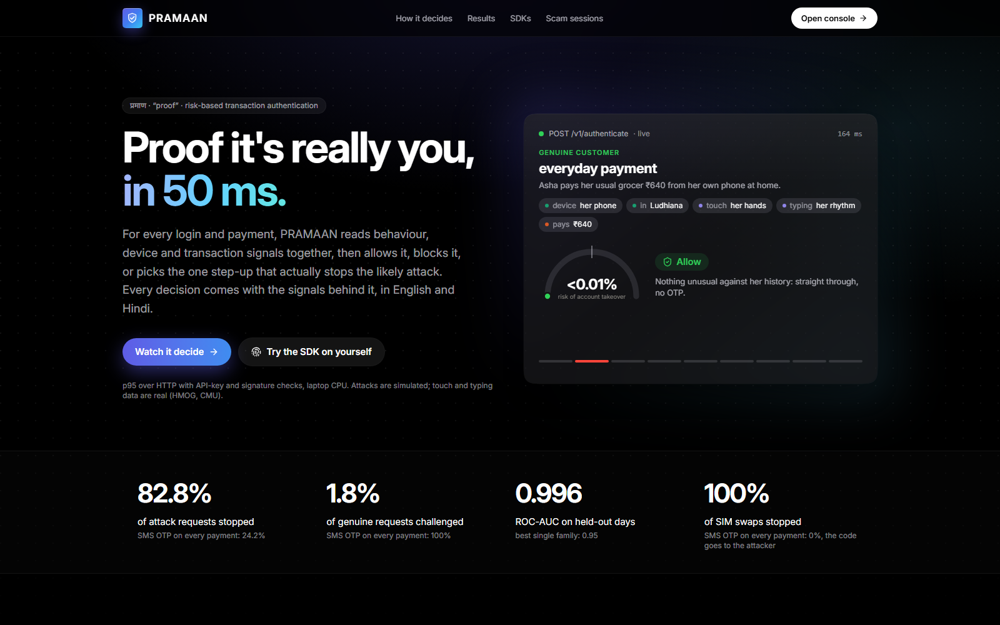
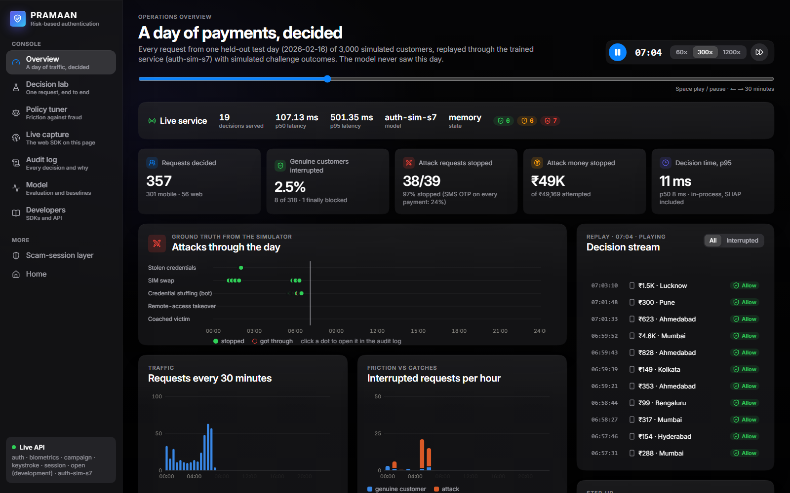
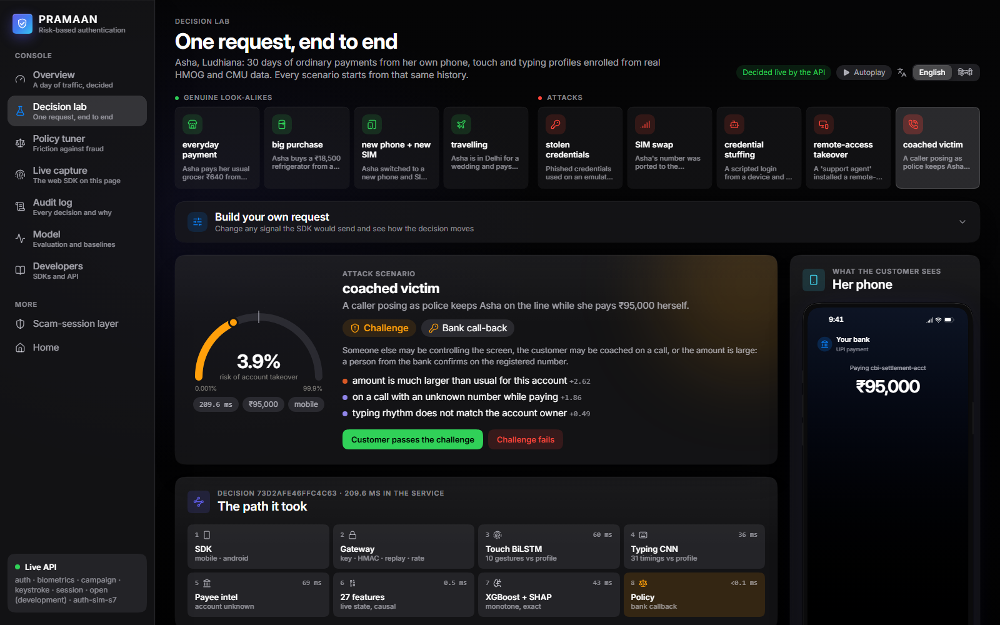
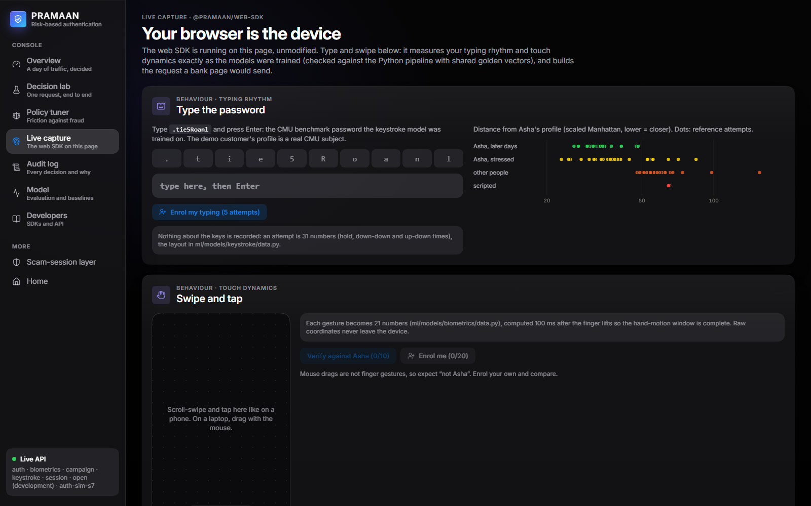
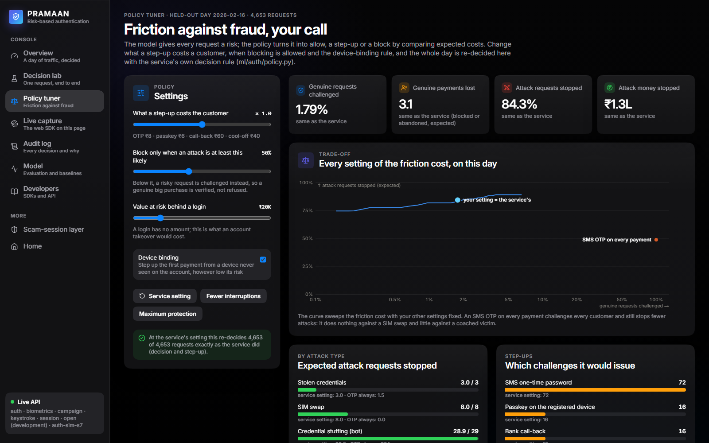
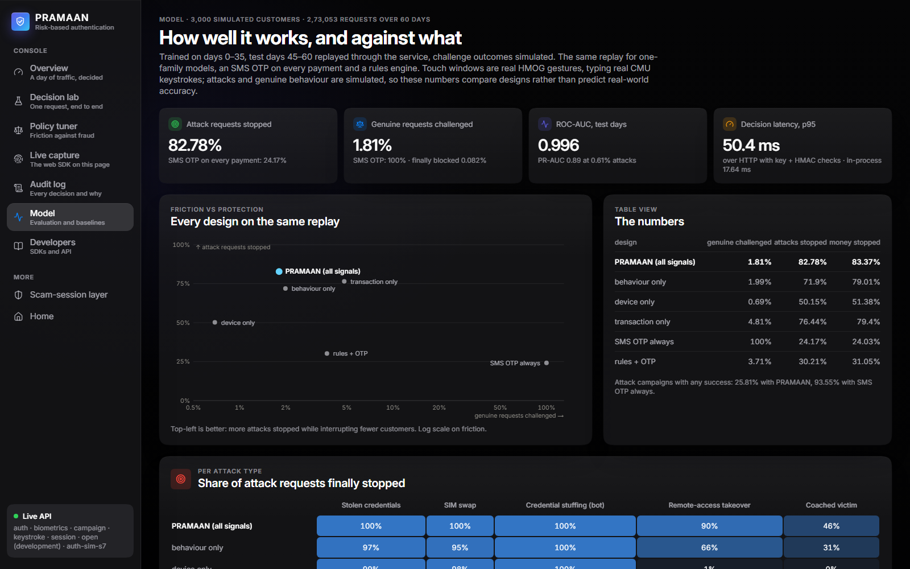

# PRAMAAN: fast, explainable authentication for online payments

**PRAMAAN** (प्रमाण, "proof") stands for **P**arallel **R**isk-**A**daptive **M**ulti-modal **A**uthentication &
**A**nomaly **N**etwork. Team **CaffeineEaters**: Abhinav Saini, Aditi Pundir, Mannat Kaur, Aryamann Sharma.

For every login or payment, PRAMAAN combines **behaviour**, **device information** and **transaction patterns**,
decides **allow / challenge / block** in real time, picks the step-up that actually stops the likely attack, and returns
**the signals behind the decision**.

```
POST /v1/authenticate      ->  { decision, risk_score, challenge_type, reasons (EN/HI), signals (tree-SHAP), latency_ms }
POST /v1/challenge/verify  ->  passed: allow (+ trust the device) · failed: block, lock 30 min
```

> **What the numbers mean.** Attack and genuine behaviours are **simulated**. Touch windows and typing attempts are
> **real** data (HMOG, CMU) scored by the real models. Challenge efficacies are **assumptions**. The results validate
> the service and compare designs; they are not real-world fraud rates.

| | |
|---|---|
|  |  |
|  |  |
|  |  |

---

## Run it

No API keys, GPU, Docker, database or dataset downloads are needed: the trained models ship in this repository.

**You need:** [Python 3.11](https://www.python.org/downloads/), [Node.js 20+](https://nodejs.org/) and a few GB of disk
space for the dependencies.

**Windows (PowerShell)**

```powershell
git clone https://github.com/abhinavtop1G/PayPal_AI_Hackathon_Pramaan.git
cd PayPal_AI_Hackathon_Pramaan
py -3.11 -m venv .venv
.venv\Scripts\python -m pip install torch==2.14.1 --index-url https://download.pytorch.org/whl/cpu
.venv\Scripts\python -m pip install -r requirements-serve.txt
.venv\Scripts\python run.py
```

**macOS / Linux**

```bash
git clone https://github.com/abhinavtop1G/PayPal_AI_Hackathon_Pramaan.git
cd PayPal_AI_Hackathon_Pramaan
python3.11 -m venv .venv
.venv/bin/python -m pip install torch==2.14.1 --index-url https://download.pytorch.org/whl/cpu
.venv/bin/python -m pip install -r requirements-serve.txt
.venv/bin/python run.py
```

`run.py` starts the API, installs the console's dependencies on the first run, then starts the console. When it prints
`Open http://localhost:3000`, open that address. **Ctrl+C** stops everything.

| | |
|---|---|
| Console | <http://localhost:3000> |
| API docs (Swagger, try any endpoint in the browser) | <http://127.0.0.1:8000/docs> |
| API only, without the console | `python run.py --api-only` |

The sidebar should say **Live API**. The first visit to each page takes a few seconds while Next.js compiles it.

**Just want to look around, with no Python?** `cd frontend && npm ci && npm run dev` runs the console on its own. It plays
recordings of the API's output and labels them **Recorded**.

### If something goes wrong

| What you see | What to do |
|---|---|
| `Port 8000 is already in use` (or 3000) | Stop whatever is using it, or run `python run.py --api-port 8001 --web-port 3001` |
| `Missing Python packages` | Run the script with the `.venv` Python, as in the commands above |
| `py` is not recognised (Windows) | Use the full path to your Python 3.11, or `python -m venv .venv` if `python --version` says 3.11 |
| pip can't find a pinned version | Check you are on Python 3.11: the versions are pinned to the ones the models were saved with |
| Sidebar says **Recorded** | The console can't reach the API. Check the API is still running in the terminal and that `/health` answers |

---

## Use it

A five-minute tour, in the order that makes the most sense.

**1. Watch it decide: [`/console/lab`](http://localhost:3000/console/lab).** Pick a scenario from the top row. You get the
risk score, the decision, the reasons in English or Hindi, the time each pipeline stage took, the SHAP waterfall behind
the score, what the customer sees on their phone, and the exact request and response. This is what you should see:

| scenario | decision | step-up | risk |
|---|---|---|---|
| everyday payment | allow | | <0.01% |
| big purchase | challenge | SMS OTP | 0.11% |
| new phone + new SIM | challenge | passkey | 0.12% |
| travelling | allow | | <0.01% |
| stolen credentials | block | | 99.2% |
| SIM swap | block | | 94.4% |
| credential stuffing | block | | 92.8% |
| remote-access takeover | block | | 95.9% |
| coached victim | challenge | bank call-back | 3.9% |

- On a **challenge**, press **Customer passes the challenge** or **Challenge fails** to run the rest of the loop.
- Open **Build your own request** to change any signal the SDK would send and watch the decision move.

**2. Try it on yourself: [`/console/capture`](http://localhost:3000/console/capture).** The real web SDK runs on this page.
Type the password `.tie5Roanl` and press Enter to see your typing rhythm against the demo customer's real profile, or enrol
your own in 5 attempts. Swipe on the pad to see the 21 features computed per gesture.

**3. Tune the policy: [`/console/policy`](http://localhost:3000/console/policy).** Change what a step-up costs a customer or
when blocking is allowed. A whole recorded day is re-decided in your browser, using the service's own decision rule.

**4. See a day of traffic: [`/console`](http://localhost:3000/console).** Press play to replay 4,653 requests from a held-out
test day on a compressed clock. The **Live service** strip above the charts shows the running API's own counters.

**5. Check the evidence.**
[`/console/audit`](http://localhost:3000/console/audit) lists every decision, with filters, a detail drawer and CSV export.
[`/console/model`](http://localhost:3000/console/model) compares every design on the same replay.
[`/console/developers`](http://localhost:3000/console/developers) has SDK quickstarts and a playground for sending requests.

**6. The scam-session layer: [`/scam`](http://localhost:3000/scam).** The earlier RAKSHAM work this builds on: a phone demo of
scam sessions (a fake police "digital arrest" call, for example), the bank's view of a day of sessions, the mule network, and
a builder for scoring a session event by event.

**Or call the API directly** (in Windows PowerShell, type `curl.exe`):

```bash
curl -s http://127.0.0.1:8000/health
curl -s -X POST http://127.0.0.1:8000/v1/auth/demo/sim_swap -H "Content-Type: application/json" -d "{}"
```

### What is live and what is recorded

Nothing on screen is made up, but not everything is computed on the spot, so here is exactly which is which.

| on screen | source |
|---|---|
| Decision lab, landing-page decision card, scenario table | **Live** from the API; falls back to a recording of the API's output, labelled as such |
| Live capture, API playground, the audit log's live view, Live service strip | **Live** from the API |
| `/scam` phone demo, mule network, session builder | **Live** from the API; the phone demo and mule network fall back to recordings, the builder needs the API |
| Overview, policy tuner, the audit log's recorded day, `/scam` bank wall | **Recording** of one held-out day run through the trained service: regenerating it takes the full simulator |
| Headline figures, Model page | **Evaluation reports** in this repo (`model_report.json`, built from `ml/reports/` and `backend/reports/`) |

---

## Results

Sources: [`ml/reports/auth.md`](ml/reports/auth.md), [`backend/reports/auth_latency.md`](backend/reports/auth_latency.md).
3,000 simulated customers, 273k requests over 60 days; trained on days 0-35, tested on days 45-60 replayed through the
service, including simulated challenge outcomes.

| design | genuine requests challenged | genuine finally blocked | attack requests stopped | attack money stopped |
|---|---|---|---|---|
| **risk engine (all signals)** | **1.8%** | **0.08%** | **82.8%** | **83.4%** |
| behaviour signals only (touch + typing + session) | 2.0% | 0.10% | 71.9% | 79.0% |
| device signals only | 0.7% | 0.04% | 50.2% | 51.4% |
| transaction signals only | 4.8% | 0.23% | 76.4% | 79.4% |
| SMS OTP on every payment | 100% | 3.0% | 24.2% | 24.0% |
| rules engine + SMS OTP | 3.7% | 0.12% | 30.2% | 31.1% |

- **Ranking:** test ROC-AUC 0.996 with all signals, against 0.88 / 0.76 / 0.95 for one family alone.
- **Per attack (finally stopped):** stolen credentials 100%, SIM swap 100%, bots 100%, remote-access takeover 90%,
  **coached victim 46%**. The real owner on their own phone is the hardest case. Hard-difficulty attacks: 68%.
- **Typing rhythm** ([`ml/reports/keystroke_cmu.md`](ml/reports/keystroke_cmu.md)): a 1D-CNN keystroke encoder trained on the
  CMU DSL-StrongPassword data. On people it never saw, enrolled on 4 earlier sessions and tested on 4 later ones: per-user
  EER 13.0% (scaled Manhattan 19.9%; fused 12.3%).
- **Device binding:** the first payment from a device never seen on the account is always stepped up, however low the
  model's risk.
- **Latency** over HTTP on a laptop CPU, with API-key and HMAC checks on: **p95 50 ms** without touch data, **p95 66 ms** with
  10 touch gestures verified by the BiLSTM. Neither row sends a typing attempt, which adds a few ms for the CNN. Reproduce
  with `python -m backend.bench_auth`; expect different numbers on a different machine or under load.

---

## How it works

Each request runs through: SDK signals → gateway (API key, HMAC signature, replay check, rate limit) → touch BiLSTM and
typing 1D-CNN → payee intelligence → 27 causal features (behaviour 6, device 13, transaction 8) → monotone XGBoost with exact
tree-SHAP → an expected-cost policy → allow, one of four step-ups (SMS OTP, passkey, bank call-back, cool-off), or block.

Details: [`docs/ARCHITECTURE.md`](docs/ARCHITECTURE.md). Deployment: [`docs/DEPLOY.md`](docs/DEPLOY.md).

### API

| endpoint | what it does |
|---|---|
| `POST /v1/authenticate` | decide a login / payment: decision, risk, challenge type, EN/HI reasons, all signal contributions, the base log-odds they add up from, per-stage timings |
| `POST /v1/challenge/verify` | result of the step-up → final allow / block; passkey or call-back makes the device trusted |
| `POST /v1/biometrics/enroll` · `/verify` | enrol a user's touch profile (≥ 20 gestures) · score 10-20 gestures against it |
| `POST /v1/keystroke/enroll` · `/verify` | enrol a user's typing rhythm (≥ 5 password / PIN attempts, 31 key timings each) · score one attempt |
| `GET /v1/auth/decisions` · `/v1/auth/stats` | audit feed and counters (decisions, challenge mix, p50/p95 latency) |
| `GET /v1/auth/scenarios` · `POST /v1/auth/demo/{scenario}` · `POST /v1/auth/demo/verify` | demo customer (open paths for the public console) |
| `GET /health` | loaded services, security mode, model version, state / audit backends |

`run.py` starts the API in open development mode. To turn security on, set the environment variables in
[`docs/DEPLOY.md`](docs/DEPLOY.md): `X-API-Key`; `X-Timestamp` + `X-Signature` = HMAC-SHA256 of `"<timestamp>.<body>"` with a
5-minute window and replay rejection; per-key token-bucket rate limit.

### Client SDKs

[`sdk/`](sdk/README.md) holds a **web SDK** (`@pramaan/web-sdk`, TypeScript) and an **Android SDK** (`com.pramaan.sdk`, Kotlin),
both without dependencies. They collect touch gestures (21 features each, never coordinates), typing rhythm (31 timings,
never keys), session timing and device signals on the customer's device. Their clients sign requests, retry safely and fall
back to an SMS OTP when the service is down. Both are tested against **golden vectors from the training pipeline's own code**:
the same raw input must give the features the models were trained on, to 1e-9.

### Repository layout

```
run.py            starts the API and console together
backend/          FastAPI: app.py, auth_service.py, security.py, audit.py; scripts that write the console's data
frontend/         Next.js console: / (product), /console/* , /scam
ml/auth/          the authentication core: features, simulator, model, policy, engine, evaluation
ml/models/        touch biometrics (BiLSTM), typing (1D-CNN), workflow GRU, GNN, tabular, each with shipped weights
ml/campaign, ml/engine, ml/sim    the earlier RAKSHAM components: payee risk, scam sessions, simulator
ml/reports/       the evaluation reports every published number comes from
infra/privacy/    consent, private set intersection, reputation
sdk/              web and Android SDKs, golden vectors
deploy/, Dockerfile, docker-compose.yml    cloud deployment
docs/             architecture, deployment, the RAKSHAM write-ups
tests/            backend test suite
```

---

## Tests

```bash
.venv/bin/python -m pip install pytest httpx
.venv/bin/python -m pytest tests -q                         # 107 passed, 16 skipped (these need the training datasets or a GPU)
cd frontend && npm test                                     # 4 tests: the policy tuner against the recorded decisions
cd sdk/web && npm ci && npm test                            # 31 tests; 7 more with: PRAMAAN_API=http://127.0.0.1:8000 npm run test:live
cd sdk/android && gradle :pramaan:testDebugUnitTest         # 13 tests (needs Gradle and the Android SDK)
```

The backend suite trains small models and takes several minutes on a laptop CPU.

## Rebuild from data (optional)

Not needed to run anything. Training needs the datasets, which are not in this repository: HMOG
(`DATA/hmog_dataset.zip`), CMU DSL-StrongPassword (`DATA/keystroke/DSL-StrongPasswordData.csv`) and, for the RAKSHAM
components, IBM AML and IEEE-CIS. Install `requirements.txt` for the full training environment, then:

```bash
python -m ml.models.biometrics.data      # HMOG gesture cache (once)
python -m ml.models.keystroke.train --seed 0   # typing encoder (seeds 0-2)
python -m ml.models.keystroke.evaluate   # held-out users vs baselines -> ml/reports/keystroke_cmu.md
python -m ml.auth.evaluate               # simulate, train, evaluate -> ml/reports/auth.md + model
python -m ml.auth.demo                   # packed demo gestures
BIO_CALIB=ml/auth/artifacts/bio_calib.pkl python -m backend.record_auth_demo   # recording of the scenarios
python -m backend.record_auth_traffic    # recording of one held-out day
python -m backend.export_console_report  # evaluation reports -> frontend/public/data/model_report.json
python sdk/spec/make_golden.py           # SDK golden vectors
```

## Cloud deployment

[`docs/DEPLOY.md`](docs/DEPLOY.md) covers Docker and Google Cloud Run. The Dockerfile and deploy script **have not been run
yet**; the service has only been run locally.

## Project history

PRAMAAN is built on RAKSHAM, the team's earlier scam-detection work, which contributed the touch-biometrics model, the
payee-risk model and the API skeleton. Its write-ups are in [`docs/README_RAKSHAM.md`](docs/README_RAKSHAM.md) and
[`docs/ARCHITECTURE_RAKSHAM.md`](docs/ARCHITECTURE_RAKSHAM.md).

This repository carries the project's real commit history. It opens on 15 October 2026 with a file-by-file import of the
earlier code, then adds the PRAMAAN service, console and SDKs, up to `f001f93` on 25 October 2026.

Commits after `f001f93` were made for this submission:

- `run.py`, a single command that starts the API and console
- headline figures now read from the evaluation reports instead of being typed into the pages, which fixed stale numbers on
  the `/scam` policy panel
- the landing-page card and scenario table decide live when the API is up
- latency re-measured on the current code
- a duplicate-key bug in the landing-page card fixed
- the repository cleaned up, and this README rewritten

## Acknowledgements

Touch data: the HMOG dataset. Typing data: the CMU Keystroke Dynamics benchmark (Killourhy and Maxion). The RAKSHAM components
also use the IBM AML and IEEE-CIS Fraud Detection datasets.
